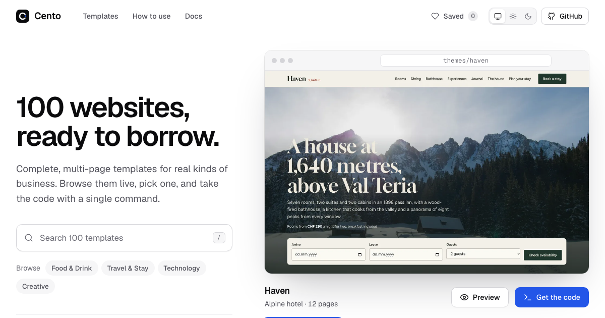
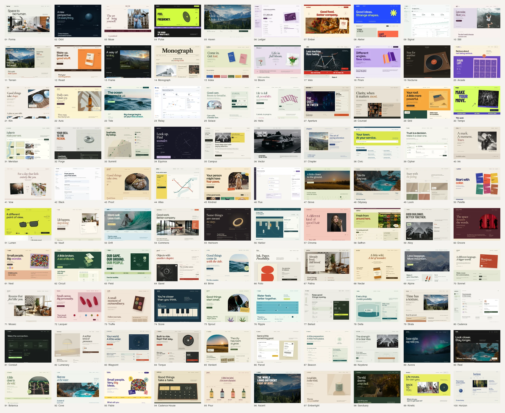

<div align="center">

# Cento

### 100 websites, ready to borrow.

One hundred complete, multi-page website templates — each a different world. Browse them live, preview every page, take the code with one command.

**[Browse the templates →](https://cento.koative.com/)**


</div>

[](https://cento.koative.com/)

A _cento_ is a poem made entirely of lines borrowed from other poems; the word is also Italian for a hundred. This repository is both: a hundred complete websites, built to be borrowed.

Every template is a real site, not a landing-page skin:

- **7–17 page templates each**, 12–57 routes once detail pages are counted: collections with filters and search, detail pages, about, journal or docs, a 404.
- **Working flows in the browser** — carts and checkouts, booking calendars, enquiry and application forms with validation, quote calculators, and full `/app` demos for the SaaS templates. Nothing is sent or charged.
- **A different world every time** — its own sector, layout, palette, typeface pairing and one signature interaction you will not find in the others.
- **One file to rebrand** — all copy and data live in `src/content.ts`; design tokens sit at the top of `src/styles.css`.
- **Standalone** — each folder is an independent Vite + React + TypeScript app with self-hosted fonts, local images and relative paths, so its build runs from any static host or subfolder.

## Borrow a template

```sh
npx degit koative/cento/themes/roast my-site
cd my-site
bun install   # or npm / pnpm / yarn
bun run dev
```

Replace `roast` with any folder from the catalogue below. `bun run build` writes a static site to `dist/`.

Routes are hash-based (`#/shop/guji-natural`), so the build needs no server rewrites. Interactive state (carts, saved plans) lives in `localStorage`, and every flow keeps working when storage is unavailable.

## The catalogue



### Technology (16)

| No. | Template                          | Sector                       | Pages | Signature                                                                              | Demo                                                  |
| --- | --------------------------------- | ---------------------------- | ----- | -------------------------------------------------------------------------------------- | ----------------------------------------------------- |
| 002 | **[Orbit](themes/orbit)**         | Space launch startup         | 11    | Rideshare calculator, Launch manifest, Vehicle spec sheets, Mission patches            | [Live ↗](https://cento.koative.com/themes/orbit/)     |
| 006 | **[Ledger](themes/ledger)**       | Personal finance app         | 17    | Paycheck allocator, App demo, Envelope budget, Card freeze                             | [Live ↗](https://cento.koative.com/themes/ledger/)    |
| 009 | **[Signal](themes/signal)**       | Product analytics SaaS       | 15    | Live query composer, App demo, Funnel builder, Pricing calculator                      | [Live ↗](https://cento.koative.com/themes/signal/)    |
| 026 | **[Helix](themes/helix)**         | Quantum computing company    | 10    | Circuit composer, Qubit lattice explorer, Papers library, Cloud pricing estimator      | [Live ↗](https://cento.koative.com/themes/helix/)     |
| 038 | **[Cipher](themes/cipher)**       | Cybersecurity SaaS           | 15    | Access review with signed attestation, App demo, Trust center, Pricing calculator      | [Live ↗](https://cento.koative.com/themes/cipher/)    |
| 041 | **[Stack](themes/stack)**         | Developer documentation      | 10    | Docs shell, API playground, Docs search, Changelog                                     | [Live ↗](https://cento.koative.com/themes/stack/)     |
| 044 | **[Flux](themes/flux)**           | Workflow automation SaaS     | 17    | Workflow builder, Live test runs, Integrations directory, App demo                     | [Live ↗](https://cento.koative.com/themes/flux/)      |
| 062 | **[Cadence](themes/cadence)**     | Hiring & ATS software        | 16    | Interview loop composer, Pipeline board demo, Interview kit scorecards, Pricing toggle | [Live ↗](https://cento.koative.com/themes/cadence/)   |
| 063 | **[Conduit](themes/conduit)**     | API integration platform     | 17    | Live request console, Connectors directory, Status page, App demo                      | [Live ↗](https://cento.koative.com/themes/conduit/)   |
| 070 | **[Lucid](themes/lucid)**         | AI writing assistant SaaS    | 15    | Live prompt demo, Tracked-changes review, App editor demo, House style guide           | [Live ↗](https://cento.koative.com/themes/lucid/)     |
| 071 | **[Streak](themes/streak)**       | Habit-tracking mobile app    | 10    | Interactive chain calendar, CSS phone mockups, Help centre, Blog                       | [Live ↗](https://cento.koative.com/themes/streak/)    |
| 073 | **[Sprint](themes/sprint)**       | Project management SaaS      | 14    | Sprint capacity planner, Keyboard-movable board, App demo, Pricing calculator          | [Live ↗](https://cento.koative.com/themes/sprint/)    |
| 074 | **[Pipeline](themes/pipeline)**   | CRM & sales software         | 13    | Forecast call, Deals board demo, Contacts & timeline, Seat pricing                     | [Live ↗](https://cento.koative.com/themes/pipeline/)  |
| 083 | **[Shortlist](themes/shortlist)** | Job board                    | 10    | Job search, Shortlist compare, Salary checker, Post a job                              | [Live ↗](https://cento.koative.com/themes/shortlist/) |
| 084 | **[Guild](themes/guild)**         | Freelance marketplace        | 12    | Time-zone crew planner, Talent directory, Project brief builder, Fee calculator        | [Live ↗](https://cento.koative.com/themes/guild/)     |
| 097 | **[Manual](themes/manual)**       | Help center & knowledge base | 13    | Instant search, Guided troubleshooter, Status page, Community forum                    | [Live ↗](https://cento.koative.com/themes/manual/)    |

### Commerce (13)

| No. | Template                        | Sector                      | Pages | Signature                                                                          | Demo                                                 |
| --- | ------------------------------- | --------------------------- | ----- | ---------------------------------------------------------------------------------- | ---------------------------------------------------- |
| 003 | **[Muse](themes/muse)**         | Fashion label               | 11    | Lookbook with shop-the-look, Online shop, Store hours, Checkout                    | [Live ↗](https://cento.koative.com/themes/muse/)     |
| 015 | **[Index](themes/index)**       | Independent bookstore       | 10    | Card catalogue drawer, Online bookshop, Events & RSVP, Book club membership        | [Live ↗](https://cento.koative.com/themes/index/)    |
| 016 | **[Bloom](themes/bloom)**       | Florist                     | 12    | Bouquet builder, Delivery checkout, Subscriptions, Wedding enquiries               | [Live ↗](https://cento.koative.com/themes/bloom/)    |
| 017 | **[Velo](themes/velo)**         | Bicycle shop & builds       | 9     | Bike shop, Build configurator, Service booking, Rides club                         | [Live ↗](https://cento.koative.com/themes/velo/)     |
| 021 | **[Kiln](themes/kiln)**         | Ceramics studio & shop      | 11    | Glaze bench configurator, Online shop, Workshop booking, Firing calendar           | [Live ↗](https://cento.koative.com/themes/kiln/)     |
| 022 | **[Aura](themes/aura)**         | Skincare brand              | 12    | Ritual builder, Ingredients glossary, Online shop, Journal                         | [Live ↗](https://cento.koative.com/themes/aura/)     |
| 046 | **[Lumen](themes/lumen)**       | Eyewear brand               | 11    | Face-shape finder, Live frame configurator, Eye test booking, Lens thickness guide | [Live ↗](https://cento.koative.com/themes/lumen/)    |
| 050 | **[Heirloom](themes/heirloom)** | Jewelry atelier             | 11    | Ring builder, Online shop, Appointment booking, Bespoke process                    | [Live ↗](https://cento.koative.com/themes/heirloom/) |
| 052 | **[Saffron](themes/saffron)**   | Grocery market & delivery   | 10    | Delivery slot board, Shop-the-recipe, Online grocery, Swap preferences             | [Live ↗](https://cento.koative.com/themes/saffron/)  |
| 058 | **[Patina](themes/patina)**     | Vintage furniture store     | 11    | Online shop, Doorway fit check, Room sets, Sell-to-us form                         | [Live ↗](https://cento.koative.com/themes/patina/)   |
| 072 | **[Hush](themes/hush)**         | Noise-cancelling headphones | 10    | Noise lab with Web Audio, Colour picker, Compare models, Cart & checkout           | [Live ↗](https://cento.koative.com/themes/hush/)     |
| 075 | **[Drop](themes/drop)**         | Streetwear store            | 11    | Drops calendar, Raffle tickets, Size-run stock, Cart & checkout                    | [Live ↗](https://cento.koative.com/themes/drop/)     |
| 100 | **[Tinker](themes/tinker)**     | Toy store                   | 12    | Shop by age, Gift finder, Workshop booking, Gift wrap                              | [Live ↗](https://cento.koative.com/themes/tinker/)   |

### Food & Drink (8)

| No. | Template                        | Sector                     | Pages | Signature                                                       | Demo                                                 |
| --- | ------------------------------- | -------------------------- | ----- | --------------------------------------------------------------- | ---------------------------------------------------- |
| 007 | **[Ember](themes/ember)**       | Neighbourhood restaurant   | 9     | Table planner, Reservations, Private dining, Supper-club events | [Live ↗](https://cento.koative.com/themes/ember/)    |
| 012 | **[Roast](themes/roast)**       | Coffee roastery            | 10    | Online shop, Subscription builder, Brew timer, Roast curves     | [Live ↗](https://cento.koative.com/themes/roast/)    |
| 019 | **[Nocturne](themes/nocturne)** | Cocktail & listening bar   | 10    | Drinks menu, Record of the night, Table booking, Private hire   | [Live ↗](https://cento.koative.com/themes/nocturne/) |
| 042 | **[Proof](themes/proof)**       | Artisan bakery             | 11    | Oven board, Order-ahead shop, Pickup planner, Class booking     | [Live ↗](https://cento.koative.com/themes/proof/)    |
| 066 | **[Pour](themes/pour)**         | Natural wine shop & bar    | 12    | Taste finder, Online shop, Tastings booking, Wine club          | [Live ↗](https://cento.koative.com/themes/pour/)     |
| 086 | **[Smash](themes/smash)**       | Burger joint with ordering | 11    | Burger builder, Online ordering, Catering estimator, Merch shop | [Live ↗](https://cento.koative.com/themes/smash/)    |
| 095 | **[Kettle](themes/kettle)**     | Craft brewery & taproom    | 12    | Flight builder, Tour booking, Pickup shop, Age gate             | [Live ↗](https://cento.koative.com/themes/kettle/)   |
| 099 | **[Pantry](themes/pantry)**     | Meal kit subscription      | 9     | Plan builder, Weekly menu, Recipe pages, Sign-up checkout       | [Live ↗](https://cento.koative.com/themes/pantry/)   |

### Travel & Stay (6)

| No. | Template                        | Sector                  | Pages | Signature                                                                   | Demo                                                 |
| --- | ------------------------------- | ----------------------- | ----- | --------------------------------------------------------------------------- | ---------------------------------------------------- |
| 005 | **[Haven](themes/haven)**       | Alpine hotel            | 12    | Availability calendar, Room-view panorama, Booking flow, Dining & spa menus | [Live ↗](https://cento.koative.com/themes/haven/)    |
| 011 | **[Terrain](themes/terrain)**   | Guided adventure travel | 10    | Route finder, Day-by-day route explorer, Packing checklist, Booking flow    | [Live ↗](https://cento.koative.com/themes/terrain/)  |
| 045 | **[Odyssey](themes/odyssey)**   | Travel agency           | 11    | Itinerary planner, Route chart, Season charts, Enquiry flow                 | [Live ↗](https://cento.koative.com/themes/odyssey/)  |
| 048 | **[Drift](themes/drift)**       | Surf school & camps     | 10    | Surf forecast widget, Camp finder, Lesson & camp booking, Coach profiles    | [Live ↗](https://cento.koative.com/themes/drift/)    |
| 087 | **[Hideaway](themes/hideaway)** | Vacation rental villas  | 9     | Availability calendar, Live stay quote, Island map, Booking flow            | [Live ↗](https://cento.koative.com/themes/hideaway/) |
| 093 | **[Roam](themes/roam)**         | Car rental              | 9     | Booking flow, Bag fit planner, Station map, Deal codes                      | [Live ↗](https://cento.koative.com/themes/roam/)     |

### Health & Wellness (10)

| No. | Template                      | Sector                   | Pages | Signature                                                                          | Demo                                                |
| --- | ----------------------------- | ------------------------ | ----- | ---------------------------------------------------------------------------------- | --------------------------------------------------- |
| 010 | **[Still](themes/still)**     | Yoga & meditation studio | 11    | Breathing guide, Class schedule, Class booking, Memberships                        | [Live ↗](https://cento.koative.com/themes/still/)   |
| 025 | **[Solace](themes/solace)**   | Family health clinic     | 9     | Appointment booking, Live appointment card, Clinic map & hours, Clinician profiles | [Live ↗](https://cento.koative.com/themes/solace/)  |
| 030 | **[Tempo](themes/tempo)**     | Dance studio             | 10    | Timetable planner, Tap-tempo style finder, Trial booking, Events RSVP              | [Live ↗](https://cento.koative.com/themes/tempo/)   |
| 033 | **[Summit](themes/summit)**   | Climbing gym             | 11    | Interactive route map, Day-pass booking, Classes timetable, Membership calculator  | [Live ↗](https://cento.koative.com/themes/summit/)  |
| 051 | **[Chroma](themes/chroma)**   | Hair salon               | 10    | Chair-time planner, Online booking, Lookbook formulas, Shade level chart           | [Live ↗](https://cento.koative.com/themes/chroma/)  |
| 077 | **[Iron](themes/iron)**       | Gym & personal training  | 10    | Class timetable, Programme builder, Plate loader, Join flow                        | [Live ↗](https://cento.koative.com/themes/iron/)    |
| 078 | **[Enamel](themes/enamel)**   | Dental clinic            | 10    | Tooth chart estimator, Online booking, Treatment price list, Membership plan       | [Live ↗](https://cento.koative.com/themes/enamel/)  |
| 079 | **[Whisker](themes/whisker)** | Veterinary clinic        | 11    | Appointment booking, Vaccine care planner, Health plans, Emergency guide           | [Live ↗](https://cento.koative.com/themes/whisker/) |
| 091 | **[Vital](themes/vital)**     | Telehealth service       | 10    | Symptom check-in, Live visit slip, Live wait board, Plan pricing toggle            | [Live ↗](https://cento.koative.com/themes/vital/)   |
| 094 | **[Fade](themes/fade)**       | Barbershop               | 12    | Fade chart builder, Chair booking, Barber profiles, Product shop                   | [Live ↗](https://cento.koative.com/themes/fade/)    |

### Services (10)

| No. | Template                        | Sector                         | Pages | Signature                                                                 | Demo                                                 |
| --- | ------------------------------- | ------------------------------ | ----- | ------------------------------------------------------------------------- | ---------------------------------------------------- |
| 028 | **[Counsel](themes/counsel)**   | Law firm                       | 10    | Limitation clock, People directory, Fee schedule, Enquiry intake          | [Live ↗](https://cento.koative.com/themes/counsel/)  |
| 031 | **[Meridian](themes/meridian)** | Real estate agency             | 11    | Map search, Floor plans, Valuation estimator, Neighborhood guides         | [Live ↗](https://cento.koative.com/themes/meridian/) |
| 040 | **[Vow](themes/vow)**           | Wedding planner                | 9     | Countdown planner, Packages by guest count, Wedding stories, Enquiry form | [Live ↗](https://cento.koative.com/themes/vow/)      |
| 047 | **[Vault](themes/vault)**       | Home & renters insurance       | 8     | Quote builder, Live policy schedule, Contents counter, Claims triage      | [Live ↗](https://cento.koative.com/themes/vault/)    |
| 049 | **[Commons](themes/commons)**   | Coworking space                | 10    | Meeting-room board, Interactive floor plans, Events & RSVP, Memberships   | [Live ↗](https://cento.koative.com/themes/commons/)  |
| 076 | **[Surge](themes/surge)**       | Growth marketing agency        | 9     | ROI model, Experiment readouts, Case studies, Proposal form               | [Live ↗](https://cento.koative.com/themes/surge/)    |
| 080 | **[Quadrant](themes/quadrant)** | Management consultancy         | 9     | Priority matrix, Exhibit charts, Industry heatmap, Enquiry form           | [Live ↗](https://cento.koative.com/themes/quadrant/) |
| 081 | **[Tally](themes/tally)**       | Small-business accounting firm | 9     | Tax deadline calendar, Packages pricing, Book a call, Resource library    | [Live ↗](https://cento.koative.com/themes/tally/)    |
| 092 | **[Fixture](themes/fixture)**   | Plumbing & electrical services | 8     | Instant estimate, Service-area map, Emergency triage, Visit booking       | [Live ↗](https://cento.koative.com/themes/fixture/)  |
| 098 | **[Cohort](themes/cohort)**     | Venture capital firm           | 10    | Round modeller, Portfolio tombstones, Pitch form, Essays                  | [Live ↗](https://cento.koative.com/themes/cohort/)   |

### Creative (11)

| No. | Template                      | Sector                      | Pages | Signature                                                                              | Demo                                                |
| --- | ----------------------------- | --------------------------- | ----- | -------------------------------------------------------------------------------------- | --------------------------------------------------- |
| 001 | **[Forma](themes/forma)**     | Architecture studio         | 8     | Light study, Project register, Case pages, Enquiry form                                | [Live ↗](https://cento.koative.com/themes/forma/)   |
| 008 | **[Atelier](themes/atelier)** | Creative agency             | 8     | Brief builder, Case studies, Work index, Careers                                       | [Live ↗](https://cento.koative.com/themes/atelier/) |
| 013 | **[Frame](themes/frame)**     | Photographer portfolio      | 9     | Contact-sheet viewer, Marked frames enquiry, Editioned prints shop, Wall-scale preview | [Live ↗](https://cento.koative.com/themes/frame/)   |
| 020 | **[Arcade](themes/arcade)**   | Indie game studio           | 10    | Playable canvas demo, Pixel-art key art, Press kit, Job applications                   | [Live ↗](https://cento.koative.com/themes/arcade/)  |
| 039 | **[Ink](themes/ink)**         | Tattoo studio               | 9     | Flash book, Stencil sizer, Healing clock, Booking request                              | [Live ↗](https://cento.koative.com/themes/ink/)     |
| 060 | **[Mosaic](themes/mosaic)**   | Interior design studio      | 10    | Sample-board builder, Material library, Consultation booking, Project timeline         | [Live ↗](https://cento.koative.com/themes/mosaic/)  |
| 064 | **[Reel](themes/reel)**       | Documentary film production | 7     | Trailer player, Production board, Screenings programme, Enquiry form                   | [Live ↗](https://cento.koative.com/themes/reel/)    |
| 067 | **[Tilde](themes/tilde)**     | Developer portfolio         | 10    | Working shell, Case studies, Dotfiles browser, resume.json view                        | [Live ↗](https://cento.koative.com/themes/tilde/)   |
| 068 | **[Margin](themes/margin)**   | Product designer portfolio  | 7     | Redline case studies, Design playground, Printable résumé, Enquiry form                | [Live ↗](https://cento.koative.com/themes/margin/)  |
| 088 | **[Riff](themes/riff)**       | Band & musician             | 12    | Persistent record player, Tour dates & tickets, Merch store, Press kit                 | [Live ↗](https://cento.koative.com/themes/riff/)    |
| 089 | **[Channel](themes/channel)** | Video creator & merch       | 12    | Chaptered video player, Merch shop, Memberships, Media kit                             | [Live ↗](https://cento.koative.com/themes/channel/) |

### Culture & Media (10)

| No. | Template                          | Sector                     | Pages | Signature                                                                          | Demo                                                  |
| --- | --------------------------------- | -------------------------- | ----- | ---------------------------------------------------------------------------------- | ----------------------------------------------------- |
| 004 | **[Pulse](themes/pulse)**         | Music festival             | 9     | Timetable builder, Artist pages, Ticket checkout, Venue map                        | [Live ↗](https://cento.koative.com/themes/pulse/)     |
| 014 | **[Monograph](themes/monograph)** | Independent magazine       | 10    | Article reader, Issue archive, Subscriptions, Contributors                         | [Live ↗](https://cento.koative.com/themes/monograph/) |
| 018 | **[Prism](themes/prism)**         | Design conference          | 11    | Agenda builder, Speaker profiles, Ticket registration, Venue floor plan            | [Live ↗](https://cento.koative.com/themes/prism/)     |
| 027 | **[Aperture](themes/aperture)**   | Independent cinema         | 9     | Seat-picker booking, Sightline preview, Weekly programme, Venue hire estimate      | [Live ↗](https://cento.koative.com/themes/aperture/)  |
| 036 | **[Chapter](themes/chapter)**     | Podcast network            | 11    | Chapter-marked player, Listening list, Show pages, Ad campaign planner             | [Live ↗](https://cento.koative.com/themes/chapter/)   |
| 054 | **[Encore](themes/encore)**       | Theatre                    | 8     | Seat map with view preview, Booking flow, Membership tiers, Access performances    | [Live ↗](https://cento.koative.com/themes/encore/)    |
| 057 | **[Folio](themes/folio)**         | Contemporary art gallery   | 13    | True-scale wall preview, Viewing room shortlist, Live opening hours, Editions shop | [Live ↗](https://cento.koative.com/themes/folio/)     |
| 065 | **[Fable](themes/fable)**         | Children's museum          | 9     | Floor map & day planner, Timed tickets, School trip requests, Party packages       | [Live ↗](https://cento.koative.com/themes/fable/)     |
| 069 | **[Dispatch](themes/dispatch)**   | Newsletter & personal blog | 8     | Post reader, Delivery calendar, Subscribe tiers, Sponsor booking                   | [Live ↗](https://cento.koative.com/themes/dispatch/)  |
| 096 | **[Clutch](themes/clutch)**       | Esports team               | 12    | Round-by-round replay, Player pages, Jersey name print, Match centre               | [Live ↗](https://cento.koative.com/themes/clutch/)    |

### Education & Community (11)

| No. | Template                      | Sector                          | Pages | Signature                                                                              | Demo                                                |
| --- | ----------------------------- | ------------------------------- | ----- | -------------------------------------------------------------------------------------- | --------------------------------------------------- |
| 023 | **[Tide](themes/tide)**       | Ocean conservation nonprofit    | 9     | Tide planner, Volunteer booking, Impact reports, Donate flow                           | [Live ↗](https://cento.koative.com/themes/tide/)    |
| 034 | **[Campus](themes/campus)**   | Online course platform          | 12    | Course catalogue, Pace planner, Learning workspace demo, Sign-up flow                  | [Live ↗](https://cento.koative.com/themes/campus/)  |
| 037 | **[Civic](themes/civic)**     | City government services        | 10    | Report on a map, Trash-day & ward lookup, Council agendas, Service alerts              | [Live ↗](https://cento.koative.com/themes/civic/)   |
| 043 | **[Kindred](themes/kindred)** | Pet adoption shelter            | 10    | Matching quiz, Kennel-card listings, Adoption application, Donate flow                 | [Live ↗](https://cento.koative.com/themes/kindred/) |
| 055 | **[Nest](themes/nest)**       | Childcare & nursery             | 9     | Fees calculator, Rooms by age, Day in the life, Tour booking                           | [Live ↗](https://cento.koative.com/themes/nest/)    |
| 056 | **[Field](themes/field)**     | Community sports club           | 9     | Team sheet builder, Fixtures & results, Age-group team finder, Membership registration | [Live ↗](https://cento.koative.com/themes/field/)   |
| 059 | **[Sonnet](themes/sonnet)**   | Language school                 | 9     | Level test, Course catalogue, Weekly timetable, Enrolment form                         | [Live ↗](https://cento.koative.com/themes/sonnet/)  |
| 061 | **[Score](themes/score)**     | Music school                    | 11    | Playable keyboard + staff, Metronome & tuner, Trial lesson booking, Recital season     | [Live ↗](https://cento.koative.com/themes/score/)   |
| 082 | **[Lantern](themes/lantern)** | Community charity & fundraising | 9     | Live totaliser board, Donate flow, Event RSVP, Open-book reports                       | [Live ↗](https://cento.koative.com/themes/lantern/) |
| 085 | **[Mentor](themes/mentor)**   | Online coach & course creator   | 10    | Manager's Wheel self-assessment, Coaching application, Podcast player, Free worksheets | [Live ↗](https://cento.koative.com/themes/mentor/)  |
| 090 | **[Quad](themes/quad)**       | University                      | 10    | Programme finder, Module planner, Campus map, Application form                         | [Live ↗](https://cento.koative.com/themes/quad/)    |

### Industry (5)

| No. | Template                    | Sector                     | Pages | Signature                                                                         | Demo                                               |
| --- | --------------------------- | -------------------------- | ----- | --------------------------------------------------------------------------------- | -------------------------------------------------- |
| 024 | **[Relay](themes/relay)**   | Freight logistics platform | 17    | Shipment tracker, Quote calculator, Network map, Shipments app demo               | [Live ↗](https://cento.koative.com/themes/relay/)  |
| 029 | **[Grid](themes/grid)**     | Home solar & energy        | 10    | Roof solar planner, Energy-flow day, Financing calculator, Multi-step quote       | [Live ↗](https://cento.koative.com/themes/grid/)   |
| 032 | **[Forge](themes/forge)**   | Precision manufacturing    | 8     | Part configurator, RFQ with file upload, First-article report, Capability filters | [Live ↗](https://cento.koative.com/themes/forge/)  |
| 035 | **[Vector](themes/vector)** | Electric car maker         | 11    | Car configurator, Range estimator, Charging calculator, Test-drive booking        | [Live ↗](https://cento.koative.com/themes/vector/) |
| 053 | **[Alloy](themes/alloy)**   | Construction company       | 9     | Build programme scrubber, Project index, Tender & estimate form, Careers          | [Live ↗](https://cento.koative.com/themes/alloy/)  |

## Work on the collection

```sh
bun install
bun run dev                       # gallery + every template at http://localhost:5173/
bun scripts/check-theme.mjs roast # crawl one template at 1440 and 390 px, report defects, save screenshots to .qa/
bun run build && bun run test     # production build, then the Playwright suite against it
```

The gallery reads each template's `themes/<slug>/cento.json`, so a new folder with metadata appears in the catalogue automatically. See [scripts/README.md](scripts/README.md) for the preview and font tooling.

## Credits

Code is MIT. Photographs, fonts and icons keep their own licences: see [ASSETS.md](ASSETS.md) and each template's `src/assets/SOURCES.md`. Every brand, person, price and figure in the templates is fictional.

Made by [koative](https://koative.com)
