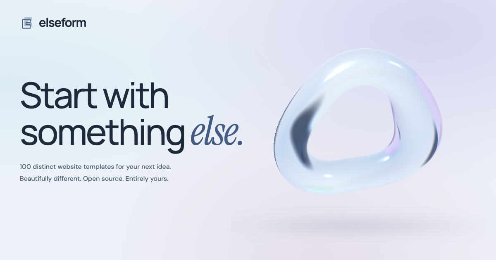

<div align="center">

<picture>
  <source media="(prefers-color-scheme: dark)" srcset="public/elseform-wordmark-dark.svg" />
  
</picture>

### Start with something else.

100 distinct website templates. Beautifully different. Open source. Entirely yours.

**[Explore the collection →](https://koative.github.io/elseform/)** · **[Koative](https://koative.com)**


</div>

[](https://koative.github.io/elseform/)

**Elseform** is an independent design collection by [Koative](https://koative.com). Find a starting point, explore a live demo, and make it your own.

This collection brings together one hundred deliberately different websites: photographic editorials, kinetic posters, spatial experiments, useful dashboards, and thoughtful storefronts. Each template owns its layout, typography, color palette, motion and interactions. These are separate design directions, not one hundred skins on the same landing page.

## Gallery appearance

Choose **Light**, **Dark** or **System** in the gallery. System follows your device’s appearance; an explicit choice is remembered on this device when browser storage is available. If storage is unavailable, the selected appearance still works for the current visit.

Appearance changes apply to the Elseform gallery and preview shell. Each template keeps its own visual identity, including inside the live preview.

## The collection


| Template                                 | World                   | Signature                                   | Live demo                                                            |
| ---------------------------------------- | ----------------------- | ------------------------------------------- | -------------------------------------------------------------------- |
| **[Forma](themes/forma)**                | Architecture            | Editorial, Project index                    | [Explore ↗](https://koative.github.io/elseform/themes/forma/)        |
| **[Orbit](themes/orbit)**                | Aerospace               | 3D motion, Interactive                      | [Explore ↗](https://koative.github.io/elseform/themes/orbit/)        |
| **[Muse](themes/muse)**                  | Fashion                 | Art direction, Collection                   | [Explore ↗](https://koative.github.io/elseform/themes/muse/)         |
| **[Pulse](themes/pulse)**                | Music & events          | Kinetic type, Schedule                      | [Explore ↗](https://koative.github.io/elseform/themes/pulse/)        |
| **[Haven](themes/haven)**                | Hospitality             | Immersive, Reservations                     | [Explore ↗](https://koative.github.io/elseform/themes/haven/)        |
| **[Ledger](themes/ledger)**              | Finance                 | Workspace, 3D card                          | [Explore ↗](https://koative.github.io/elseform/themes/ledger/)       |
| **[Ember](themes/ember)**                | Restaurant              | Menu, Table booking                         | [Explore ↗](https://koative.github.io/elseform/themes/ember/)        |
| **[Atelier](themes/atelier)**            | Creative studio         | Portfolio, Expressive                       | [Explore ↗](https://koative.github.io/elseform/themes/atelier/)      |
| **[Signal](themes/signal)**              | Analytics               | Dashboard, Data viz                         | [Explore ↗](https://koative.github.io/elseform/themes/signal/)       |
| **[Still](themes/still)**                | Wellness                | Slow motion, Breathing                      | [Explore ↗](https://koative.github.io/elseform/themes/still/)        |
| **[Terrain](themes/terrain)**            | Outdoor                 | Adventure, Route finder                     | [Explore ↗](https://koative.github.io/elseform/themes/terrain/)      |
| **[Roast](themes/roast)**                | Coffee shop             | Storefront, Local cart                      | [Explore ↗](https://koative.github.io/elseform/themes/roast/)        |
| **[Frame](themes/frame)**                | Photography             | Contact sheet, Image viewer                 | [Explore ↗](https://koative.github.io/elseform/themes/frame/)        |
| **[Monograph](themes/monograph)**        | Independent journal     | Editorial, Reading room                     | [Explore ↗](https://koative.github.io/elseform/themes/monograph/)    |
| **[Index](themes/index)**                | Bookstore               | Book catalog, Local bag                     | [Explore ↗](https://koative.github.io/elseform/themes/index/)        |
| **[Bloom](themes/bloom)**                | Floral studio           | Bouquet builder, Seasonal                   | [Explore ↗](https://koative.github.io/elseform/themes/bloom/)        |
| **[Velo](themes/velo)**                  | Performance cycling     | Configurator, Performance                   | [Explore ↗](https://koative.github.io/elseform/themes/velo/)         |
| **[Prism](themes/prism)**                | Design conference       | Event agenda, Tickets                       | [Explore ↗](https://koative.github.io/elseform/themes/prism/)        |
| **[Nocturne](themes/nocturne)**          | Listening bar           | 3D turntable, Listening room                | [Explore ↗](https://koative.github.io/elseform/themes/nocturne/)     |
| **[Arcade](themes/arcade)**              | Indie games             | Playable, Game studio                       | [Explore ↗](https://koative.github.io/elseform/themes/arcade/)       |
| **[Kiln](themes/kiln)**                  | Ceramic objects         | Object gallery, 3D display                  | [Explore ↗](https://koative.github.io/elseform/themes/kiln/)         |
| **[Aura](themes/aura)**                  | Skincare                | Ritual builder, Beauty                      | [Explore ↗](https://koative.github.io/elseform/themes/aura/)         |
| **[Tide](themes/tide)**                  | Ocean conservation      | Volunteer, Conservation                     | [Explore ↗](https://koative.github.io/elseform/themes/tide/)         |
| **[Relay](themes/relay)**                | Logistics               | Operations, Tracking                        | [Explore ↗](https://koative.github.io/elseform/themes/relay/)        |
| **[Solace](themes/solace)**              | Healthcare clinic       | Healthcare, Booking, Calm                   | [Explore ↗](https://koative.github.io/elseform/themes/solace/)       |
| **[Helix](themes/helix)**                | Biotechnology           | Research library, Molecular model           | [Explore ↗](https://koative.github.io/elseform/themes/helix/)        |
| **[Aperture](themes/aperture)**          | Independent cinema      | Cinematic, Programme, Tickets               | [Explore ↗](https://koative.github.io/elseform/themes/aperture/)     |
| **[Counsel](themes/counsel)**            | Law practice            | Legal, Editorial, Enquiry                   | [Explore ↗](https://koative.github.io/elseform/themes/counsel/)      |
| **[Grid](themes/grid)**                  | Renewable Energy        | Solar planner, Daylight model               | [Explore ↗](https://koative.github.io/elseform/themes/grid/)         |
| **[Tempo](themes/tempo)**                | Dance studio            | Kinetic, Timetable, Bold                    | [Explore ↗](https://koative.github.io/elseform/themes/tempo/)        |
| **[Meridian](themes/meridian)**          | Real estate             | Property, Map, Search                       | [Explore ↗](https://koative.github.io/elseform/themes/meridian/)     |
| **[Forge](themes/forge)**                | Precision Manufacturing | CSS 3D, Industrial, Configurator            | [Explore ↗](https://koative.github.io/elseform/themes/forge/)        |
| **[Summit](themes/summit)**              | Climbing gym            | Route map, Hold walkthrough                 | [Explore ↗](https://koative.github.io/elseform/themes/summit/)       |
| **[Equinox](themes/equinox)**            | Planetarium             | Celestial atlas, Visit planner              | [Explore ↗](https://koative.github.io/elseform/themes/equinox/)      |
| **[Campus](themes/campus)**              | Online learning         | Learning workspace, Observation study       | [Explore ↗](https://koative.github.io/elseform/themes/campus/)       |
| **[Vector](themes/vector)**              | Automotive              | Cinematic, Automotive, Configurator         | [Explore ↗](https://koative.github.io/elseform/themes/vector/)       |
| **[Chapter](themes/chapter)**            | Podcast publication     | Editorial, Audio, Journal                   | [Explore ↗](https://koative.github.io/elseform/themes/chapter/)      |
| **[Civic](themes/civic)**                | Public services         | Government, Directory, Search               | [Explore ↗](https://koative.github.io/elseform/themes/civic/)        |
| **[Cipher](themes/cipher)**              | Cybersecurity           | Access review, Quiet, Product UI            | [Explore ↗](https://koative.github.io/elseform/themes/cipher/)       |
| **[Ink](themes/ink)**                    | Tattoo studio           | Flashbook, Minimal, Booking                 | [Explore ↗](https://koative.github.io/elseform/themes/ink/)          |
| **[Vow](themes/vow)**                    | Wedding planning        | Wedding, Folio, Planner                     | [Explore ↗](https://koative.github.io/elseform/themes/vow/)          |
| **[Stack](themes/stack)**                | Developer Documentation | Documentation, Code, Playground             | [Explore ↗](https://koative.github.io/elseform/themes/stack/)        |
| **[Proof](themes/proof)**                | Artisan bakery          | Tactile, Order sheet, Bakery                | [Explore ↗](https://koative.github.io/elseform/themes/proof/)        |
| **[Atlas](themes/atlas)**                | Public transport        | Route planner, Network map                  | [Explore ↗](https://koative.github.io/elseform/themes/atlas/)        |
| **[Kindred](themes/kindred)**            | Pet adoption            | Pets, Adoption, Playful                     | [Explore ↗](https://koative.github.io/elseform/themes/kindred/)      |
| **[Flux](themes/flux)**                  | Workflow Automation     | Workflow editor, Condition testing          | [Explore ↗](https://koative.github.io/elseform/themes/flux/)         |
| **[Grove](themes/grove)**                | Farm & CSA              | Seasonal, Calendar, Organic                 | [Explore ↗](https://koative.github.io/elseform/themes/grove/)        |
| **[Odyssey](themes/odyssey)**            | Travel planning         | Travel, Itinerary, Journal                  | [Explore ↗](https://koative.github.io/elseform/themes/odyssey/)      |
| **[Loom](themes/loom)**                  | Textiles & Materials    | Material library, Sample box                | [Explore ↗](https://koative.github.io/elseform/themes/loom/)         |
| **[Palette](themes/palette)**            | Art supplies            | Color lab, Mixing ramp                      | [Explore ↗](https://koative.github.io/elseform/themes/palette/)      |
| **[Lumen](themes/lumen)**                | Eyewear                 | Eyewear, 3D, Configurator                   | [Explore ↗](https://koative.github.io/elseform/themes/lumen/)        |
| **[Vault](themes/vault)**                | Insurance               | Plan explorer, Live summary                 | [Explore ↗](https://koative.github.io/elseform/themes/vault/)        |
| **[Drift](themes/drift)**                | Surf school             | Coastal, Field guide, Lessons               | [Explore ↗](https://koative.github.io/elseform/themes/drift/)        |
| **[Commons](themes/commons)**            | Coworking               | Floor plan, Day passes                      | [Explore ↗](https://koative.github.io/elseform/themes/commons/)      |
| **[Heirloom](themes/heirloom)**          | Jewelry atelier         | Jewelry, 3D rotation                        | [Explore ↗](https://koative.github.io/elseform/themes/heirloom/)     |
| **[Harbor](themes/harbor)**              | Port Operations         | Port operations, Map, Workspace             | [Explore ↗](https://koative.github.io/elseform/themes/harbor/)       |
| **[Chroma](themes/chroma)**              | Hair salon              | Lookbook, Editorial, Appointments           | [Explore ↗](https://koative.github.io/elseform/themes/chroma/)       |
| **[Saffron](themes/saffron)**            | Grocery market          | Grocery, Seasonal, Basket                   | [Explore ↗](https://koative.github.io/elseform/themes/saffron/)      |
| **[Alloy](themes/alloy)**                | Construction            | Construction, Blueprint, Project index      | [Explore ↗](https://koative.github.io/elseform/themes/alloy/)        |
| **[Encore](themes/encore)**              | Theatre                 | Theatre, Seating, Dramatic                  | [Explore ↗](https://koative.github.io/elseform/themes/encore/)       |
| **[Nest](themes/nest)**                  | Childcare               | Childcare, Timetable, Playful               | [Explore ↗](https://koative.github.io/elseform/themes/nest/)         |
| **[Circuit](themes/circuit)**            | Electronics Repair      | Repair intake, Exploded hardware            | [Explore ↗](https://koative.github.io/elseform/themes/circuit/)      |
| **[Field](themes/field)**                | Community sports        | Sports, Match hub, Community                | [Explore ↗](https://koative.github.io/elseform/themes/field/)        |
| **[Gavel](themes/gavel)**                | Auctions                | Lot catalog, Demo bidding                   | [Explore ↗](https://koative.github.io/elseform/themes/gavel/)        |
| **[Brine](themes/brine)**                | Seafood market          | Market counter, Basket, Coastal             | [Explore ↗](https://koative.github.io/elseform/themes/brine/)        |
| **[Folio](themes/folio)**                | Printmaking gallery     | Print archive, Original geometry, Shortlist | [Explore ↗](https://koative.github.io/elseform/themes/folio/)        |
| **[Patina](themes/patina)**              | Vintage furniture       | Vintage objects, Interior, Shortlist        | [Explore ↗](https://koative.github.io/elseform/themes/patina/)       |
| **[Nectar](themes/nectar)**              | Apiary & honey          | Tasting notes, 3D jar, Seasonal             | [Explore ↗](https://koative.github.io/elseform/themes/nectar/)       |
| **[Alpine](themes/alpine)**              | Ski equipment rental    | Rental calculator, Equipment, Mountain      | [Explore ↗](https://koative.github.io/elseform/themes/alpine/)       |
| **[Sonnet](themes/sonnet)**              | Language school         | Languages, Course finder, Word cards        | [Explore ↗](https://koative.github.io/elseform/themes/sonnet/)       |
| **[Mosaic](themes/mosaic)**              | Interior design         | Material library, Moodboard, Interiors      | [Explore ↗](https://koative.github.io/elseform/themes/mosaic/)       |
| **[Lacquer](themes/lacquer)**            | Nail art studio         | Color configurator, Sculptural, Beauty      | [Explore ↗](https://koative.github.io/elseform/themes/lacquer/)      |
| **[Truffle](themes/truffle)**            | Chocolate atelier       | Gift builder, 3D box, Chocolate             | [Explore ↗](https://koative.github.io/elseform/themes/truffle/)      |
| **[Score](themes/score)**                | Music lessons           | Playable piano, Web Audio, Lesson planner   | [Explore ↗](https://koative.github.io/elseform/themes/score/)        |
| **[Sprout](themes/sprout)**              | Garden nursery          | Plant finder, Garden planner, Botanical     | [Explore ↗](https://koative.github.io/elseform/themes/sprout/)       |
| **[Ripple](themes/ripple)**              | Swimming academy        | Timetable, Lane motion, Lessons             | [Explore ↗](https://koative.github.io/elseform/themes/ripple/)       |
| **[Ballast](themes/ballast)**            | Rail freight            | Dispatch board, Route motion                | [Explore ↗](https://koative.github.io/elseform/themes/ballast/)      |
| **[Delta](themes/delta)**                | Water management        | Water model, Fluid motion                   | [Explore ↗](https://koative.github.io/elseform/themes/delta/)        |
| **[Strata](themes/strata)**              | Geological survey       | Field atlas, Layer study                    | [Explore ↗](https://koative.github.io/elseform/themes/strata/)       |
| **[Cadence](themes/cadence)**            | Hiring workspace        | Hiring workspace, Shortlist                 | [Explore ↗](https://koative.github.io/elseform/themes/cadence/)      |
| **[Conduit](themes/conduit)**            | API integrations        | Event simulator, Developer tool             | [Explore ↗](https://koative.github.io/elseform/themes/conduit/)      |
| **[Lumenary](themes/lumenary)**          | Lighting design         | Object study, CSS lighting                  | [Explore ↗](https://koative.github.io/elseform/themes/lumenary/)     |
| **[Waypoint](themes/waypoint)**          | Flight school           | Heading dial, Route planner                 | [Explore ↗](https://koative.github.io/elseform/themes/waypoint/)     |
| **[Torque](themes/torque)**              | Motorcycle workshop     | Mechanical motion, Service builder          | [Explore ↗](https://koative.github.io/elseform/themes/torque/)       |
| **[Verdant](themes/verdant)**            | Urban farming           | Garden planner, Growing journal             | [Explore ↗](https://koative.github.io/elseform/themes/verdant/)      |
| **[Parcel](themes/parcel)**              | Postal shipping         | Rate calculator, Label preview              | [Explore ↗](https://koative.github.io/elseform/themes/parcel/)       |
| **[Beacon](themes/beacon)**              | Preparedness            | Household checklist, Progress states        | [Explore ↗](https://koative.github.io/elseform/themes/beacon/)       |
| **[Keystone](themes/keystone)**          | Structural engineering  | Structural diagram, Material study          | [Explore ↗](https://koative.github.io/elseform/themes/keystone/)     |
| **[Aurora](themes/aurora)**              | Northern lights lodge   | Immersive, Stay planner                     | [Explore ↗](https://koative.github.io/elseform/themes/aurora/)       |
| **[Reel](themes/reel)**                  | Documentary film        | Film archive, Editorial                     | [Explore ↗](https://koative.github.io/elseform/themes/reel/)         |
| **[Botanica](themes/botanica)**          | Botanical garden        | Field guide, Visit planner                  | [Explore ↗](https://koative.github.io/elseform/themes/botanica/)     |
| **[Cove](themes/cove)**                  | Sailing charters        | Route map, Voyages                          | [Explore ↗](https://koative.github.io/elseform/themes/cove/)         |
| **[Fable](themes/fable)**                | Children’s museum       | Playful, Programme                          | [Explore ↗](https://koative.github.io/elseform/themes/fable/)        |
| **[Cadence House](themes/cadencehouse)** | Recording studio        | 3D console, Sound studio                    | [Explore ↗](https://koative.github.io/elseform/themes/cadencehouse/) |
| **[Pour](themes/pour)**                  | Natural wine shop       | Product shelf, Case builder                 | [Explore ↗](https://koative.github.io/elseform/themes/pour/)         |
| **[Ascent](themes/ascent)**              | Paragliding school      | Adventure, Flight planner                   | [Explore ↗](https://koative.github.io/elseform/themes/ascent/)       |
| **[Emberlight](themes/emberlight)**      | Candle atelier          | Material study, Scent finder                | [Explore ↗](https://koative.github.io/elseform/themes/emberlight/)   |
| **[Sanctuary](themes/sanctuary)**        | Wildlife rescue         | Conservation, Animal journal                | [Explore ↗](https://koative.github.io/elseform/themes/sanctuary/)    |
| **[Kinetic](themes/kinetic)**            | Sports rehabilitation   | Movement, Care pathways                     | [Explore ↗](https://koative.github.io/elseform/themes/kinetic/)      |
| **[Horizon](themes/horizon)**            | Science publication     | Publication, Reading list                   | [Explore ↗](https://koative.github.io/elseform/themes/horizon/)      |

## The 100-template edition

This edition adds 36 independent templates and revisits the existing 64. The Elseform gallery brings an artistic liquid-glass identity, real screenshot previews, search, filters and responsive live demos. Save a local shortlist or use **Surprise me** to discover a design. Ten existing templates received focused improvements:

| Template                    | What changed                                                                                                                                                                                                                             |
| --------------------------- | ---------------------------------------------------------------------------------------------------------------------------------------------------------------------------------------------------------------------------------------- |
| [Helix](themes/helix)       | The molecular specimen now exposes Backbone and Surface representations, with selected-study color and metadata. Layered geometric chains replace the isolated bead ring; motion can be paused.                                          |
| [Grid](themes/grid)         | The opening now contains an isometric 24-position solar array linked to the panel count and an adjustable time-of-day generation study. The planner explains home and battery energy paths; model values remain explicitly illustrative. |
| [Vault](themes/vault)       | A local interior photograph and live plan-summary sheet replace the generic geometric hero. The sheet reflects selected home, belongings value, plan and illustrative price. Muted text contrast is stronger.                            |
| [Campus](themes/campus)     | A photographic observation study replaces the repeated yellow typographic placeholder. Shape, Light and Rhythm lenses change the crop and teaching prompt while preserving lesson progress and notes.                                    |
| [Loom](themes/loom)         | Material selection and specifications form a two-column workspace. The active detail is sticky beside the swatch grid on desktop and follows it on mobile. Procedural fabric studies use more visible weave and fold depth.              |
| [Palette](themes/palette)   | Pigment specimens now choose a mixing input. Five proportion swatches let visitors compare and select blends. Mixed and saved color text chooses contrasting black or white from relative luminance.                                     |
| [Circuit](themes/circuit)   | An interactive exploded phone model replaces decorative circuit paths. Visitors assemble the device or inspect its screen, power cell and logic board. Layer motion respects reduced-motion preferences.                                 |
| [Heirloom](themes/heirloom) | The ring has fourteen depth layers and visitor-controlled rotation, with an explicit animation pause. Metal and engraving controls remain independent and working.                                                                       |
| [Summit](themes/summit)     | The route map gains distinct wall facets, bolt positions and a numbered selected hold. Previous/next controls walk the six-hold sequence with bounded disabled states.                                                                   |
| [Flux](themes/flux)         | A sample project budget makes the condition meaningful. Failed conditions stop subsequent simulated actions and show skipped outcomes. Reset restores default condition and sample data.                                                 |

## Start the whole collection

Requires [Bun](https://bun.sh) 1.4.3 or newer.

```sh
git clone https://github.com/koative/elseform.git
cd elseform
bun install
bun run dev
```

Open **http://localhost:5173/elseform/**. The gallery includes search, category filters, collection/name/newest sorting, keyboard-accessible previews and desktop, tablet and mobile viewport controls. Every demo is also directly addressable at `/elseform/themes/<name>/`.

```sh
bun run check     # TypeScript validation
bun run build     # Gallery + all one hundred templates → dist/
bun run preview   # Serve the production build
bun run test      # Playwright integration checks (build first)
```

For a fresh Playwright installation, run `bunx playwright install chromium` before the integration checks.

## Take one template

Each `themes/<name>/` folder is a standalone Vite project and includes its own MIT license copy. Copy a folder out of this repository, then install and run it:

```sh
cp -R themes/forma ../my-website
cd ../my-website
bun install
bun run dev
```

`bun run build` creates that template's own `dist/` directory. Its relative base works on a static host or under a subdirectory. If you copy a template directly from GitHub, download the repository ZIP first and extract the folder you want.

Edit `src/App.tsx` for content and interactions, `src/styles.css` for the visual system, and `src/assets/` for photography. Update `index.html` with your title and metadata. Replace demo contact addresses and links back to the collection. Each folder's README explains its specific controls and assets.

## Repository map

```text
├── gallery/                 # Collection UI, catalog and preview shell
├── themes/
│   ├── forma/               # An independent React + Vite app
│   ├── orbit/
│   └── ...                  # One hundred template folders in total
├── public/previews/         # Real screenshots used by the gallery
├── tests/                   # Production-route and interaction checks
├── scripts/                 # Preview capture tooling
├── .github/workflows/       # GitHub Pages build and deployment
└── vite.config.ts           # Collection multi-page build
```

React, TypeScript and Vite form the common foundation. Bun workspaces keep dependency installation shared. The gallery includes Tailwind CSS v4; individual templates use their own scoped stylesheets so they remain easy to extract and don't depend on a shared component kit. Lucide supplies consistent interface icons.

## Motion and accessibility

The templates include CSS 3D geometry, controlled rotations, animated type and deliberate transitions. Reduced-motion preferences are respected. Interactive controls use native buttons and form elements; keyboard focus remains visible. Photography is included locally. The gallery loads a live preview only when requested instead of running one hundred websites in the background.

## Publish with GitHub Pages

This repository is configured for **https://koative.github.io/elseform/**. The root Vite base is `/elseform/`, and the production build contains a real HTML entry for every demo, so direct links do not require a single-page-app fallback.

In repository **Settings → Pages**, choose **GitHub Actions** as the build source. Push to `main` to build and deploy through `.github/workflows/pages.yml`. No custom domain is needed. This repository does not change the hosting or domain configuration of koative.com.

For a different repository path, change `base` in the root Vite configuration and update the public links in this README and `gallery/main.tsx`. For a root-domain deployment, use `/`.

## Demo boundaries

All template brands, business stories, financial balances, schedules and analytics are fictional sample content. Reservations, inquiries, purchases and transfers are front-end demonstrations: they do not send messages, take payments or persist to a server. Cart and interface state live in the current browser session unless a template documents otherwise. Connect your own backend before using those flows commercially.

The source code is available under the **[MIT license](LICENSE)**. Third-party photography and fonts retain their respective licenses; see **[ASSETS.md](ASSETS.md)** and the template READMEs. Replace photos with imagery you own when adapting a template for a real brand.

## Make it your own

Keep the personality or take it somewhere completely different. Contributions that bring a genuinely new composition, sector or interaction are welcome. Please include responsive behavior, reduced-motion support, useful demo controls and documented assets.

---

Made by **[Koative](https://koative.com)**. Independent ideas, shared openly.
